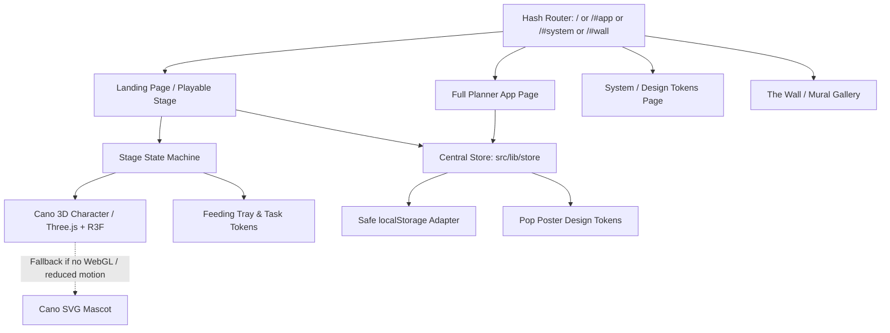

# Architecture - CAN-DO Energy Planner (v5 Feed Cano)

CAN-DO is an energy-bounded daily task planner built around the concept that your daily energy is limited paint inside a spray can character named Cano.

## High-Level System Architecture

## Directory Structure & Modules

All source files adhere strictly to the **<= 200 lines per file** standard.

- `src/styles/`:
  - `tokens.css`: Core CSS variables for Pop Poster palette, font definitions, hard shadows.
  - `tokens.ts`: `POP_TOKENS` palette, contrast calculation utilities (`getReadableTextColor`).
- `src/three/cano/`:
  - `types.ts`: Cano emotion states, skin definitions, geometry props.
  - `spring.ts`: Damped-spring physics simulation (`dampedSpring`).
  - `CanoCharacter.tsx`: Procedural 3D mesh (<10k triangles) lathe can, blinking eyes, expressive mouth, translucent belly paint gauge.
  - `AccessoriesMesh.tsx`: 6 mood accessories (glasses, headband, beret, sunhat, headphones, blanket).
  - `FaceMesh.tsx` & `LimbsMesh.tsx`: Facial features and capsule limbs.
  - `PaintGaugeMesh.tsx`: Translucent belly tube scaling with paint capacity.
  - `CanoCanvas.tsx`: R3F Canvas wrapper with DPR clamp (1.5), offscreen pause, and graceful WebGL fallback.
- `src/features/stage/`:
  - `StageHero.tsx`: Main hero interactive workspace.
  - `types.ts`: Stage state machine: `SLEEPING` -> `CHECKIN` -> `FEEDING` -> `FULL` / `OVER` -> `FOCUS` -> `DONE` / `RESTING`.
  - `StageCheckin.tsx`: 3 chunky check-in cards calculating daily capacity.
  - `StageFeedingTray.tsx`: Task feeding mechanics (drag, tap, keyboard Enter).
  - `StageStatChips.tsx`: Stacked stat chips (PAINT TODAY, IN CANO, LEFT).
  - `StageFullOverModal.tsx`: Kind modal for Full & Overfill boundary handling.
  - `StageFocusDone.tsx`: Focus timer and wall tag spray celebration.
  - `StageTopBar.tsx`: Accessible controls and mode indicators.
- `src/features/landing/`:
  - `LandingNav.tsx`: Slim sticky nav with accessible focus-trapped mobile drawer.
  - `HowItWorksSection.tsx`: 3-step explanation chips.
  - `SixMoodsSection.tsx`: Mood & skin selector re-theming the stage.
  - `BuiltForEveryoneSection.tsx`: Compact accessibility switchboard.
  - `FAQSection.tsx`: 3 key FAQs and mandatory author credits.
- `src/lib/store/`:
  - Split into `types.ts`, `storage.ts`, `initialState.ts`, `selectors.ts`, `index.ts`. Safe `localStorage` handling with error catching.
- `src/app/`:
  - Modularized planner components: `TaskCard.tsx`, `TaskForm.tsx`, `TaskBoard.tsx`, `MonthCalendarGrid.tsx`, `MonthMural.tsx`, etc.

## Principles

1. **Playable Above the Fold**: The hero is not a teaser or video; it is the interactive product.
2. **Deterministic & Private**: 100% client-side, zero runtime third-party requests, zero telemetry.
3. **Accessibility First**: Full keyboard navigability, WCAG AAA/AA computed contrast ratios, live region announcements, reduced-motion fallbacks.
